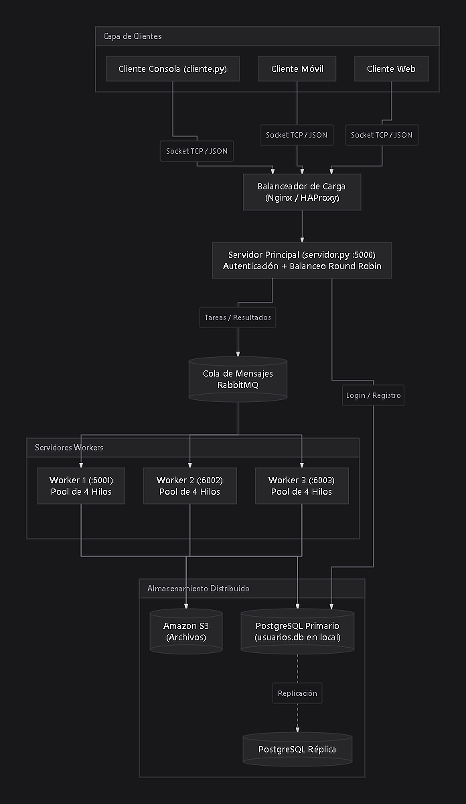
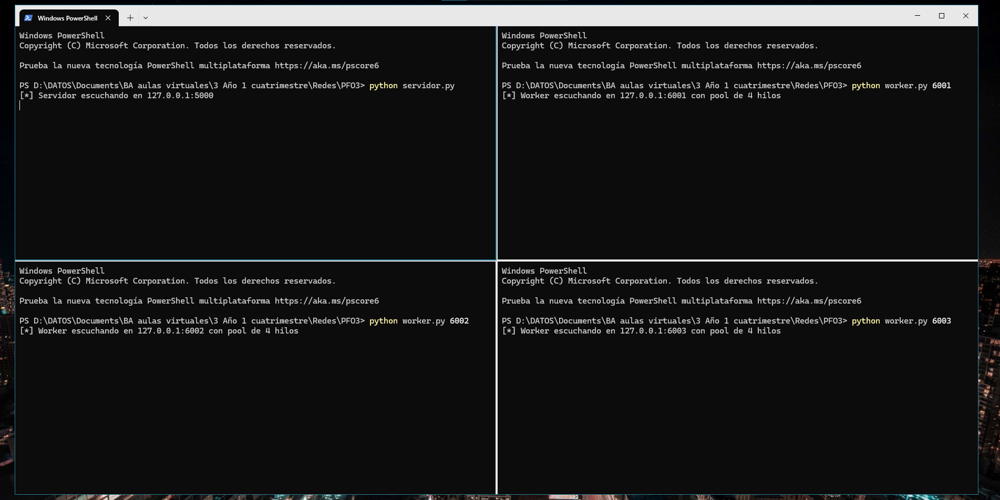
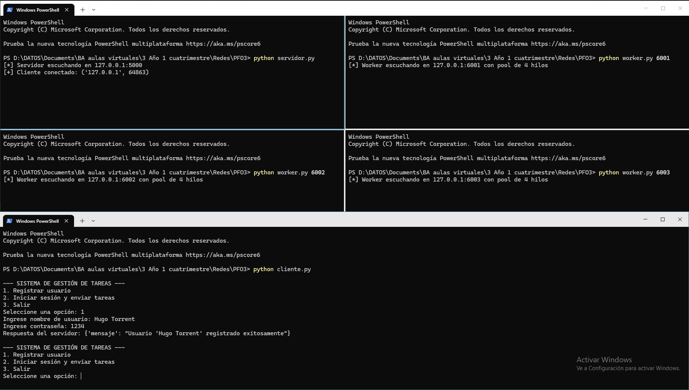
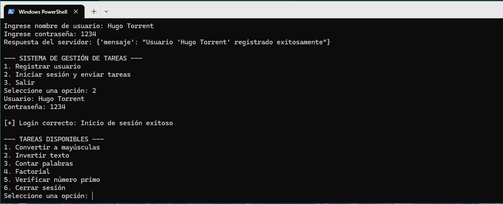
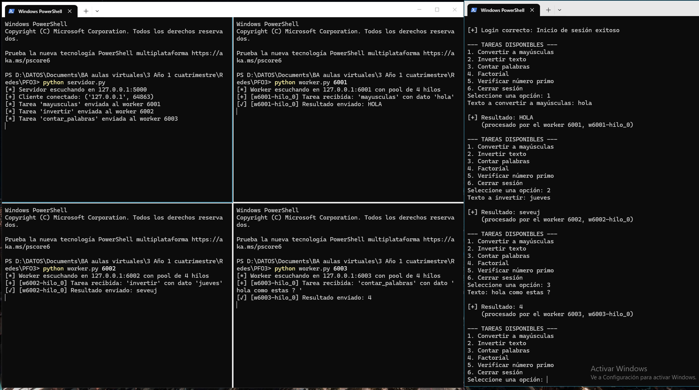
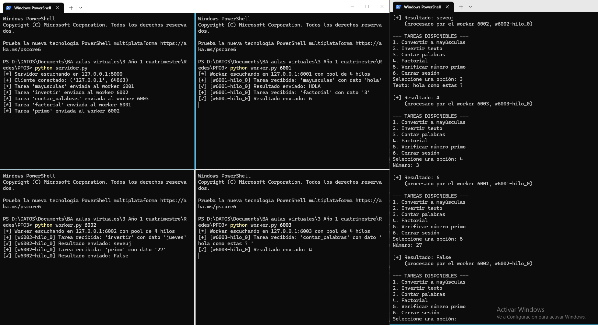
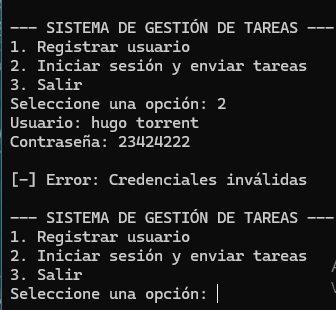
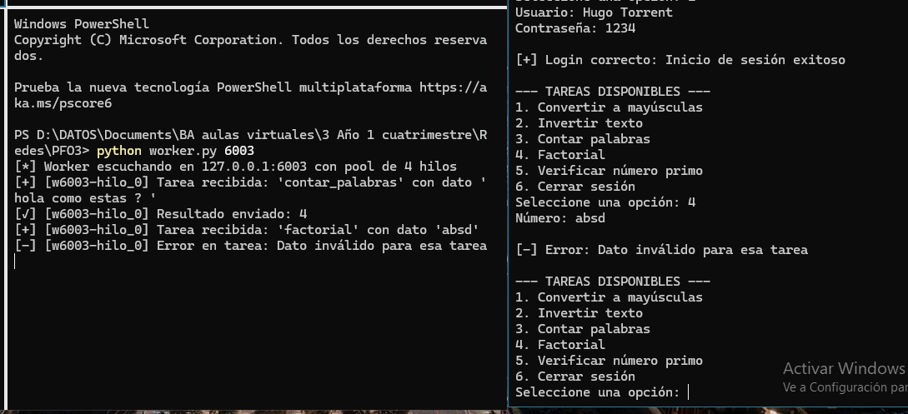
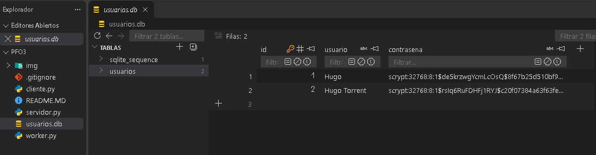

# TORRENT_HUGO_PFO3_Programacion_sobre_redes_ifts29
Transformar un sistema en una arquitectura distribuida usando sockets.

# PFO 3: Rediseño como Sistema Distribuido (Cliente-Servidor)

Este proyecto toma el sistema de la PFO 2 (registro, login y gestión de tareas con SQLite y contraseñas hasheadas) y lo transforma en una **arquitectura distribuida con sockets TCP**: el servidor autentica usuarios y reparte las tareas entre varios workers, cada uno con su propio pool de hilos.

**Objetivo:** transformar el sistema en una arquitectura distribuida usando sockets.

## Índice

1. [Punto de partida: la PFO 2](#punto-de-partida-la-pfo-2)
2. [Diagrama del sistema](#1-diagrama-del-sistema)
3. [Implementación en Python](#2-implementación-en-python)
4. [Requisitos previos](#requisitos-previos)
5. [Instalación y ejecución](#instalación-y-ejecución)
6. [Pruebas y capturas](#capturas-de-pantalla-de-pruebas-exitosas)
7. [Limitaciones y mejoras](#limitaciones-y-mejoras)

---

## Punto de partida: la PFO 2

La PFO 2 era una API REST con Flask, de un solo proceso, con registro y login de usuarios (contraseñas hasheadas), persistencia en SQLite y una vista de bienvenida en `/tareas`. En esta PFO se mantiene la lógica de usuarios y se cambia la forma de comunicarse y de procesar:

| | PFO 2 | PFO 3 |
|---|---|---|
| Comunicación | API REST con Flask (HTTP) | Sockets TCP con mensajes JSON |
| Registro / Login | `POST /registro`, `POST /login` | Acciones `registro` y `login` por socket (mismo hash con `werkzeug` y misma tabla `usuarios` en SQLite) |
| Sesión | El cliente consultaba `/tareas` tras el login | La sesión vive mientras dure la conexión del cliente |
| Tareas | `GET /tareas` mostraba un HTML de bienvenida | El usuario envía tareas que se ejecutan en los workers |
| Procesamiento | Un solo proceso | Varios workers con pool de hilos, repartidos en Round Robin |
| Cliente | Consola con `requests` | Consola con sockets, mismo menú más un submenú de tareas |

---

## 1. Diagrama del sistema



### Componentes

| Componente | Función |
|---|---|
| Clientes (móvil, web) | Envían tareas y reciben resultados. En el código se implementa el cliente de consola. |
| Balanceador de carga (Nginx / HAProxy) | Punto de entrada único; reparte las conexiones entre los servidores y controla su estado (*health checks*). |
| Servidores workers (con pool de hilos) | Ejecutan las tareas; cada uno atiende varias en simultáneo con su pool de hilos. |
| Cola de mensajes (RabbitMQ) | Comunicación entre servidores: desacopla a quien envía la tarea de quien la ejecuta y reentrega si un worker falla. |
| Almacenamiento distribuido (PostgreSQL, S3) | PostgreSQL (primario + réplica) guarda usuarios y tareas; S3 guarda archivos grandes. |

### Flujo de una tarea

1. El cliente se conecta al servidor (en el diseño completo, a través del balanceador) y se registra o inicia sesión.
2. El servidor valida las credenciales contra la base de datos (hash de la contraseña).
3. El usuario envía una tarea (por ejemplo, `factorial 10`).
4. El servidor elige un worker (Round Robin) y le envía la tarea.
5. El worker la ejecuta en un hilo de su pool y devuelve el resultado.
6. El servidor reenvía el resultado al cliente, que muestra qué worker e hilo la procesó.

### Qué se implementó y qué queda solo en el diseño

| Componente del diagrama | En el código |
|---|---|
| Cliente | `cliente.py` (consola) |
| Balanceador de carga | `servidor.py` reparte las tareas en Round Robin entre los workers |
| Workers con pool de hilos | `worker.py` con `ThreadPoolExecutor` |
| Cola de mensajes | Conexión directa por socket servidor → worker (en el diseño: RabbitMQ) |
| Almacenamiento | SQLite (`usuarios.db`) en lugar de PostgreSQL |
| Clientes móvil/web, Nginx/HAProxy, S3 | Solo en el diseño |

---

## 2. Implementación en Python

### Estructura del proyecto

```
.
├── servidor.py     # Servidor: usuarios, SQLite y distribución a workers
├── worker.py       # Worker con pool de hilos que ejecuta las tareas
├── cliente.py      # Cliente de consola
├── usuarios.db     # Base de datos SQLite (se crea automáticamente)
├── img/            # Diagrama y capturas
└── README.MD
```

### Descripción de los archivos

| Archivo | Descripción |
|---|---|
| `servidor.py` | Escucha en el puerto 5000 y atiende a cada cliente en un hilo. Registra y autentica usuarios en SQLite (contraseñas hasheadas) y distribuye las tareas a los workers. |
| `worker.py` | Escucha en su propio puerto, recibe tareas y las ejecuta en un pool de hilos (`ThreadPoolExecutor`). |
| `cliente.py` | Registra usuarios, inicia sesión, envía tareas y muestra los resultados. |

### Protocolo de comunicación

Los mensajes son objetos JSON, uno por línea (terminados en `\n`).

| Acción | Mensaje del cliente | Requiere login |
|---|---|---|
| `registro` | `{"accion": "registro", "usuario": "ana", "contraseña": "1234"}` | No |
| `login` | `{"accion": "login", "usuario": "ana", "contraseña": "1234"}` | No |
| `tarea` | `{"accion": "tarea", "tipo": "factorial", "dato": "10"}` | Sí |

Respuesta exitosa a una tarea:
```json
{"resultado": "3628800", "worker": 6001, "hilo": "w6001-hilo_0"}
```
En caso de error: `{"error": "mensaje descriptivo"}`.

### Tareas disponibles

| Tipo | Dato | Resultado |
|---|---|---|
| `mayusculas` | texto | El texto en mayúsculas |
| `invertir` | texto | El texto al revés |
| `contar_palabras` | texto | Cantidad de palabras |
| `factorial` | entero 0–2000 | Factorial del número |
| `primo` | entero | `True` si es primo, `False` si no |

### Modelo de datos

Tabla `usuarios` (la misma de la PFO 2):

| Campo | Tipo | Restricciones |
|---|---|---|
| `id` | INTEGER | Clave primaria, autoincremental |
| `usuario` | TEXT | `UNIQUE`, `NOT NULL` |
| `contrasena` | TEXT | `NOT NULL`; se guarda el hash, nunca el texto plano |

### Concurrencia y balanceo

- **Servidor:** un hilo por cliente conectado, por lo que atiende varios clientes a la vez. Cada conexión mantiene su propia sesión.
- **Worker:** `ThreadPoolExecutor` con 4 hilos por defecto (configurable). Si todos están ocupados, las tareas esperan en cola.
- **Balanceo:** Round Robin con un contador protegido por `threading.Lock`, para que las tareas simultáneas se repartan de forma pareja.

### Seguridad y manejo de errores

- Contraseñas hasheadas con `generate_password_hash` / `check_password_hash` (con *salt*), igual que en la PFO 2.
- Consultas SQL parametrizadas (`?`).
- Mensaje genérico `Credenciales inválidas`, sin revelar si falló el usuario o la contraseña.
- Las tareas exigen haber iniciado sesión.
- Puerto ocupado: el servidor y los workers muestran el error y terminan.
- Worker caído o sin respuesta (timeout): el servidor prueba con el siguiente; si no queda ninguno responde `No hay workers disponibles`.
- Datos inválidos en una tarea: el worker devuelve un error y no se cae.
- Servidor apagado: el cliente avisa que no pudo conectarse.

---

## Requisitos Previos

* Python 3.8 o superior.
* Librería `werkzeug` (viene con Flask, igual que en la PFO 2).
* Los demás módulos (`socket`, `sqlite3`, `threading`, `json`) son de la biblioteca estándar.

## Instalación y Ejecución

1. Clonar este repositorio:
   ```bash
   git clone <[https://github.com/hugotorrent/TORRENT_HUGO_PFO3_Programacion_sobre_redes_ifts29.git]>
   cd <CARPETA-DEL-REPOSITORIO>
   ```

2. Instalar las dependencias necesarias:
   ```bash
   pip install werkzeug
   ```

3. Iniciar los workers (una terminal para cada uno):
   ```bash
   python worker.py 6001
   python worker.py 6002
   python worker.py 6003
   ```
   *El segundo parámetro opcional indica el tamaño del pool de hilos (por defecto 4), por ejemplo `python worker.py 6001 8`.*

4. Iniciar el servidor (en otra terminal):
   ```bash
   python servidor.py
   ```
   *Escucha en `127.0.0.1:5000` y crea automáticamente la base de datos `usuarios.db`.*

5. Ejecutar el cliente en consola (en otra terminal):
   ```bash
   python cliente.py
   ```

### Cómo usar el cliente

1. Opción **1** para registrar un usuario.
2. Opción **2** para iniciar sesión; se abre el menú de tareas.
3. Elegir una tarea, ingresar el dato y ver el resultado junto con el worker e hilo que la procesó.
4. Opción **6** para cerrar sesión y **3** para salir.

### Configuración

| Programa | Parámetros | Por defecto |
|---|---|---|
| `worker.py` | `<puerto> [hilos]` | `6001`, `4` |
| `servidor.py` | constantes `HOST`, `PUERTO` y lista `WORKERS` al inicio del archivo | `127.0.0.1`, `5000`, workers en 6001–6003 |
| `cliente.py` | constantes `HOST` y `PUERTO` al inicio del archivo | `127.0.0.1`, `5000` |

---

## Capturas de Pantalla de Pruebas Exitosas

### 1. Servidor y Workers en ejecución (`servidor.py` y `worker.py`)
Puesta en marcha del servidor principal en el puerto 5000 y los 3 workers escuchando en los puertos 6001, 6002 y 6003 con un pool de 4 hilos cada uno:



### 2. Conexión del cliente y registro de usuario (`cliente.py`)
Ejecución del cliente en consola, conexión al servidor y registro exitoso de un nuevo usuario en SQLite:



### 3. Inicio de sesión y menú de tareas
Login exitoso con las credenciales registradas y despliegue del submenú de tareas disponibles:



### 4. Distribución de tareas en Round Robin (Parte 1)
Envío de las primeras 3 tareas (`mayusculas`, `invertir` y `contar_palabras`). Se observa cómo el servidor las reparte secuencialmente entre los workers `6001`, `6002` y `6003`, y cómo cada worker imprime la ejecución en su hilo correspondiente:



### 5. Distribución de tareas en Round Robin (Parte 2)
Envío de nuevas tareas (`factorial` y `primo`), donde el balanceador vuelve a rotar asignándolas a los workers `6001` y `6002`:



### 6. Login con credenciales inválidas
Prueba de error: el servidor rechaza el inicio de sesión cuando la contraseña o el usuario son incorrectos:



### 7. Manejo de errores ante datos inválidos en una tarea
Prueba de validación en el worker: al enviar texto (`absd`) a la tarea de `factorial`, el worker captura la excepción y devuelve el mensaje de error sin detener su ejecución:



### 8. Base de datos `usuarios.db`
Usuarios registrados en SQLite con las contraseñas almacenadas como hashes seguros (`scrypt`) y nunca en texto plano:



---


---

## Limitaciones y mejoras

- **Sin cifrado:** los sockets no usan TLS y el servidor escucha solo en `127.0.0.1`; en producción habría que cifrar el transporte (por ejemplo, desde el balanceador).
- **Hilos y GIL:** en Python, las tareas que consumen mucha CPU no se paralelizan del todo dentro de un worker; se escala agregando workers o usando procesos.
- **Reintentos:** si un worker falla en medio de una tarea, esta se reenvía a otro y podría ejecutarse más de una vez (aceptable porque las tareas no tienen efectos secundarios).
- **Servidor único:** en el prototipo hay un solo servidor; en el diseño el balanceador reparte entre varios.
- **Mejora posible:** guardar el historial de tareas de cada usuario en una tabla `tareas`.
